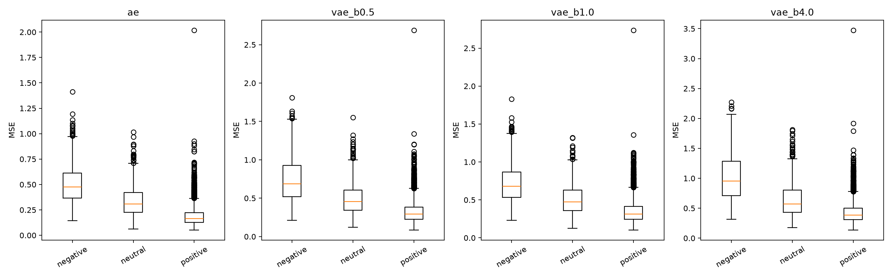
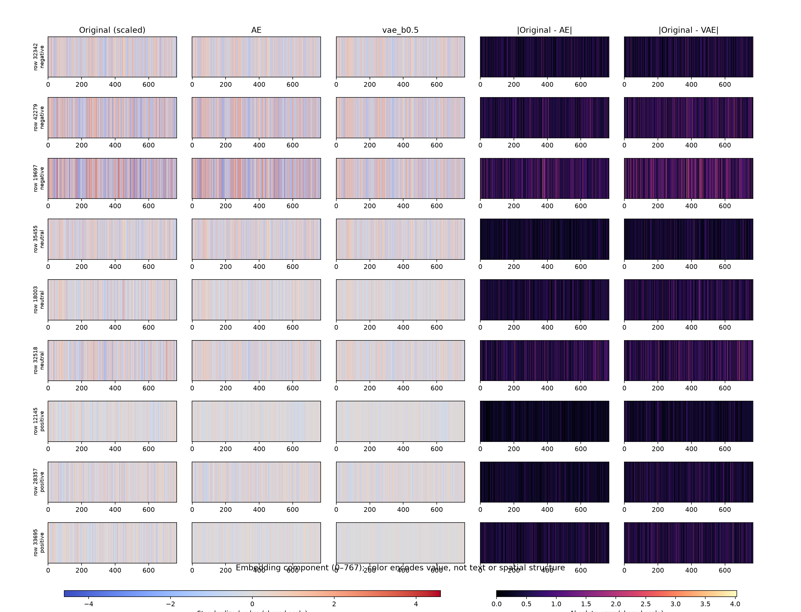
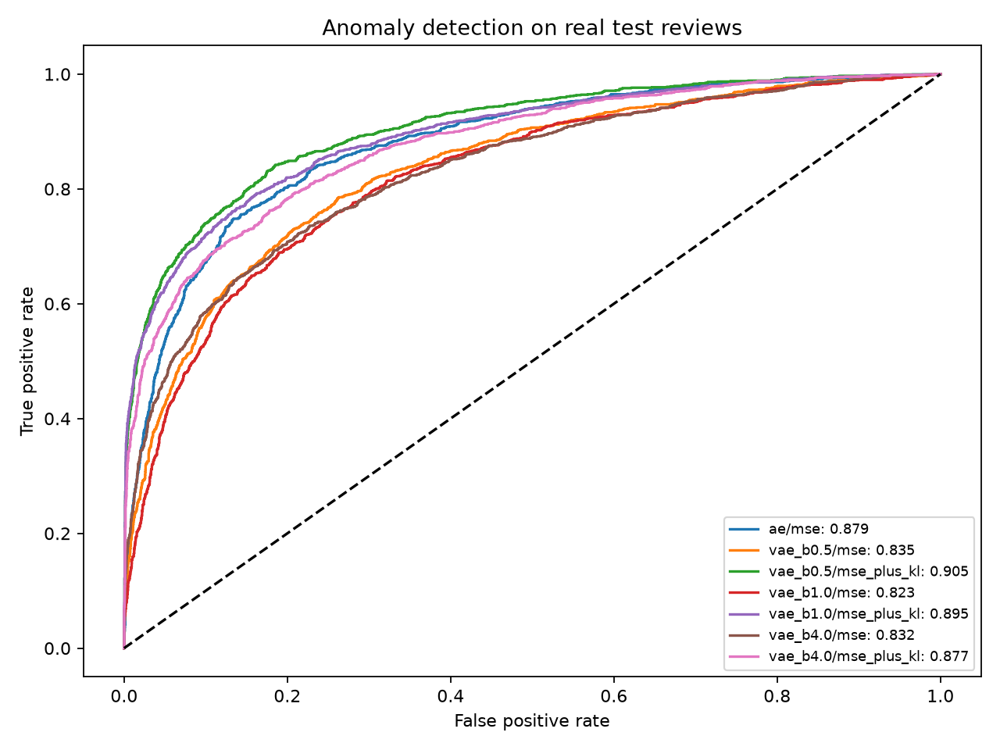
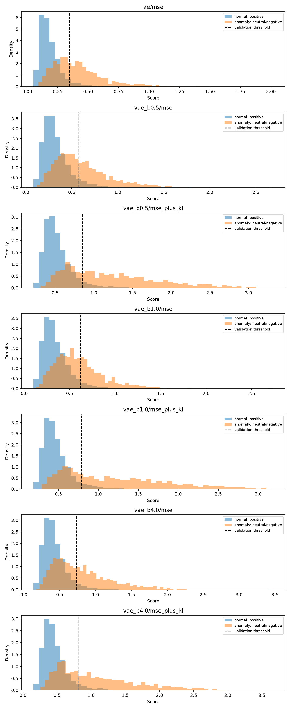
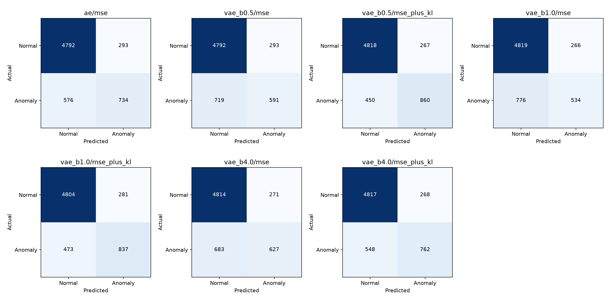
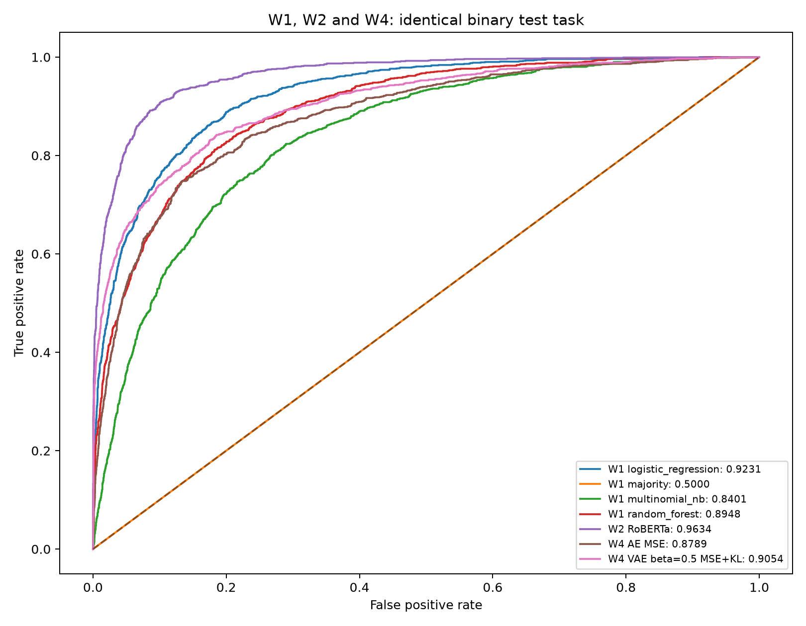

# Calidad de reconstrucción y detección de anomalías

## Datos y protocolo

Evaluamos 6.395 reseñas de prueba: 5.085 positivas (normales), 766 neutrales y 544 negativas. Las 1.310 reseñas no positivas constituyen las anomalías del experimento. Se utiliza el split congelado del Workshop 1 y embeddings de 768 componentes extraídos del transformer del Workshop 2. El normalizador guardado registra 29.842 muestras de entrenamiento y se reutiliza sin ajustarlo con validación ni prueba.

Los cuatro checkpoints evaluados tienen un espacio latente de **32 dimensiones** (compresión de 768 a 32, factor 24). Se evalúan en modo determinista: dropout desactivado y decodificación de la media μ en los VAE. Las métricas se calculan en el espacio normalizado. La correlación Pearson se calcula entre los componentes de cada vector y su reconstrucción, y después se promedia entre reseñas.

## Calidad de reconstrucción

| Modelo | MSE global | Pearson promedio | MSE positivos | MSE neutrales | MSE negativos |
|---|---:|---:|---:|---:|---:|
| ae | 0.2332 | 0.8603 | 0.1880 | 0.3356 | 0.5116 |
| vae_b0.5 | 0.3805 | 0.7417 | 0.3233 | 0.4955 | 0.7536 |
| vae_b1.0 | 0.3975 | 0.7211 | 0.3453 | 0.5081 | 0.7294 |
| vae_b4.0 | 0.5026 | 0.6442 | 0.4255 | 0.6461 | 1.0204 |

El AE presenta el menor MSE global y la mayor correlación promedio. Entre los VAE, β=0,5 tiene el menor MSE global de validación (0,3735), por lo que se selecciona para los paneles sin utilizar el test para esta elección. Al aumentar β a 1 y 4, el MSE global de prueba aumenta y la correlación disminuye en estos checkpoints. Este patrón describe los modelos disponibles; no constituye una comparación con múltiples semillas.

Las reseñas negativas son, en promedio, las más difíciles de reconstruir por MSE en los cuatro modelos, seguidas de las neutrales y las positivas. Es consistente con entrenar los modelos únicamente con positivos. Sin embargo, las negativas pueden tener mayor correlación que las positivas: Pearson mide similitud de patrón y no penaliza los cambios de escala y desplazamiento como lo hace el MSE. Por ello ambas métricas aportan información distinta.



### Paneles de muestras

Los nueve ejemplos corresponden, dentro de cada sentimiento, a posiciones cercanas a los percentiles 10, 50 y 90 del MSE del AE. Este muestreo ilustra ejemplos fáciles, intermedios y difíciles dentro de cada clase; no representa una muestra aleatoria. Los mismos ejemplos se reconstruyen con ambos modelos. Cada banda muestra las 768 componentes; las dos últimas columnas representan diferencias absolutas. Se comparten escalas de color entre reconstrucciones y entre errores. Las bandas no son imágenes del dominio ni reconstrucciones de texto.



Los identificadores originales de las muestras seleccionadas son: 32342, 42279, 19697, 35455, 18003, 32518, 12145, 28357, 33695. El corpus original ya se recuperó y verificó. El notebook incluye fragmentos de los nueve ejemplos. Las reseñas neutrales seleccionadas mezclan aspectos favorables con quejas. El negativo 19697 expresa críticas explícitas y el positivo 33695 relata una visita favorable, aunque ambos pertenecen al grupo de mayor error dentro de su clase. Esto ilustra que una reseña claramente positiva también puede reconstruirse con dificultad; los ejemplos no demuestran la causa del error.

## Detección de anomalías

Se comparan MSE del AE, MSE de cada VAE y MSE + KL de cada VAE. La KL se promedia entre dimensiones latentes, de acuerdo con la reducción implementada en la pérdida del proyecto; el score adicional no multiplica KL por β. Cada detector usa un umbral independiente: percentil 95 de scores positivos de validación. Se predice anomalía cuando el score supera ese umbral. El AUC-ROC se calcula directamente con scores continuos de prueba.

| Detector | AUC-ROC | Umbral | Precisión | Recall | F1 |
|---|---:|---:|---:|---:|---:|
| ae/mse | 0.8789 | 0.3447 | 0.7147 | 0.5603 | 0.6282 |
| vae_b0.5/mse | 0.8354 | 0.5770 | 0.6686 | 0.4511 | 0.5387 |
| vae_b0.5/mse_plus_kl | 0.9054 | 0.8530 | 0.7631 | 0.6565 | 0.7058 |
| vae_b1.0/mse | 0.8233 | 0.6169 | 0.6675 | 0.4076 | 0.5062 |
| vae_b1.0/mse_plus_kl | 0.8946 | 0.7864 | 0.7487 | 0.6389 | 0.6895 |
| vae_b4.0/mse | 0.8316 | 0.7339 | 0.6982 | 0.4786 | 0.5679 |
| vae_b4.0/mse_plus_kl | 0.8774 | 0.8041 | 0.7398 | 0.5817 | 0.6513 |

El mayor AUC observado es 0,9054 para el VAE β=0,5 con MSE + KL, frente a 0,8789 del AE con MSE: una diferencia de 0,0265. En los tres VAE, incorporar KL mejora el AUC respecto a usar únicamente su MSE. Esto muestra que la calidad de reconstrucción global y la capacidad de ordenar anomalías son propiedades distintas. El resultado se reporta como comparación descriptiva; no se realizaron pruebas de significancia ni se seleccionó un detector para despliegue a partir del test.

Con el umbral fijado en validación, VAE β=0,5 con MSE + KL detecta 860 de 1.310 anomalías, omite 450 y marca como anómalos 267 de 5.085 positivos (5,25 %). El AE detecta 734 anomalías, omite 576 y produce 293 falsos positivos (5,76 %). El objetivo aproximado de 5 % de falsas alarmas se calibra en validación y no garantiza exactamente esa tasa en prueba.







## Alcance y comparación con W1 y W2

Se recuperaron las probabilidades guardadas de W2 y se verificó su alineación por identificador y etiqueta con las 6.395 reseñas de prueba. Con score `1 − P(positivo)`, RoBERTa W2 obtiene AUC binario **0,9634**, frente a **0,8789** del AE y **0,9054** del VAE β=0,5 con MSE + KL. W2 presenta mayor separación en esta tarea, con la ventaja de entrenar directamente con sentimientos etiquetados. La comparación es descriptiva.

Se reconstruyeron también los cuatro baselines de W1 con el corpus original verificado, las funciones originales de limpieza y características, y el mismo orden de índices. Se confirmó la igualdad de las 42.632 etiquetas y los tres splits completos. La selección por macro-F1 de sentimientos en validación favorece regresión logística (0,6251), cuyo AUC binario de prueba es **0,9231**. Los demás AUC son: mayoría 0,5000; Random Forest 0,8948; Naive Bayes 0,8401. Son resultados reproducidos en el entorno registrado, no predicciones históricas recuperadas.

| Método | AUC-ROC binario de prueba |
|---|---:|
| W1 regresión logística, seleccionada en validación | 0,9231 |
| W2 RoBERTa | 0,9634 |
| W4 AE, MSE | 0,8789 |
| W4 VAE β=0,5, MSE + KL | 0,9054 |

Los clasificadores supervisados obtienen mayor AUC en esta ejecución. Su objetivo utiliza directamente etiquetas de sentimiento; AE/VAE optimizan reconstrucción de datos normales. Los embeddings de entrada de W4 también incorporan supervisión de W2. La comparación es descriptiva.



Para reproducir: `.venv/bin/python src/compare_w1.py`, `.venv/bin/python src/compare_w2.py` y `.venv/bin/python src/plot_baseline_comparison.py`. Las probabilidades y resultados quedan en `runs/workshop4/evaluation/`. Los scripts leen W1 y W2 de los repositorios vecinos y aceptan rutas alternativas mediante argumentos. No es necesario modificar esos repositorios.

El objetivo de reconstrucción de AE/VAE no utiliza etiquetas, pero los embeddings de entrada proceden de un transformer previamente supervisado y la selección de la clase normal sí utiliza sentimientos. El script de entrenamiento disponible filtra positivos; los checkpoints no permiten verificar por sí solos la procedencia exacta del entrenamiento. Además, la selección de checkpoints existente usa validación mixta y, en VAE, pérdidas con peso KL variable durante annealing. Estas decisiones se conservan y deben considerarse al interpretar los resultados.

## Reproducibilidad

```bash
XDG_CACHE_HOME=/tmp/workshop4-cache MPLCONFIGDIR=/tmp/workshop4-matplotlib .venv/bin/python src/evaluate_ae.py
```

Los resultados completos, configuraciones, versiones y hashes de checkpoints quedan en `runs/workshop4/evaluation/metrics.json`. El CSV `test_scores.csv` contiene los scores por muestra para auditoría. La evaluación usa CPU y el entorno mínimo registrado en `requirements-evaluation.txt`; no requiere ejecutar aumento de datos ni volver a entrenar.
